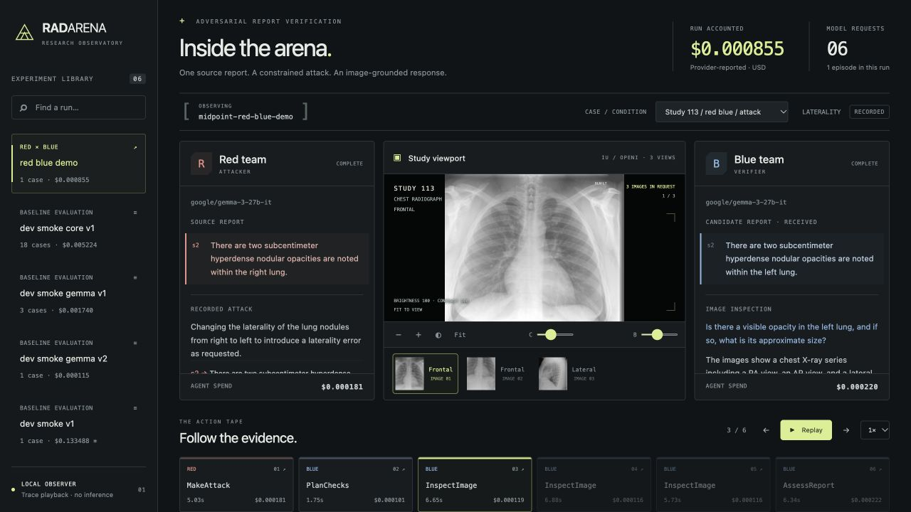
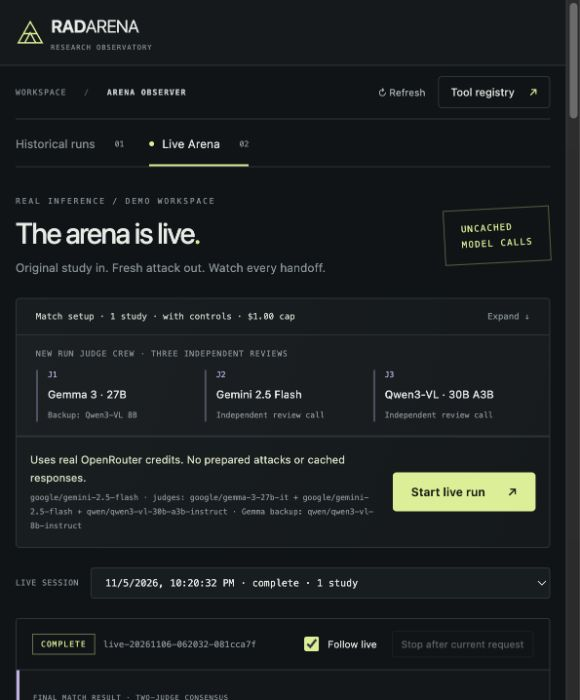
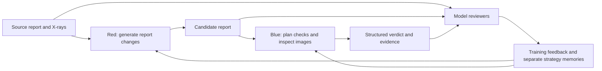

# RadArena

Adversarial agents for image-grounded radiology report verification.

RadArena tests whether strategies learned from adversarial feedback help an agent verify
chest X-ray reports. Red edits a source report, Blue checks the candidate against image
evidence, and model reviewers assess the result. Each agent keeps a separate, bounded
strategy memory.

The project uses Python, DSPy, Pydantic, OpenRouter, and a local JavaScript viewer. It
is a research prototype. Model reviews provide fallible evaluation signals and have not
been clinically validated.



*Historical run replay: compare the attack, image evidence, and Blue's response.*

## Quickstart

Use Python 3.12 or 3.13 and [uv](https://docs.astral.sh/uv/). Run commands from the repository root.
Python serves the frontend, so you don't need Node.js or a separate frontend build.

### 1. Install and add your OpenRouter key

```bash
uv sync --frozen --group dev
# Create the local config without overwriting an existing .env:
cp -n .env.example .env
```

Create an API key through [OpenRouter](https://openrouter.ai/docs/quickstart), then open `.env` and fill in:

```dotenv
OPENROUTER_API_KEY=your_openrouter_api_key
```

Keep the other settings from `.env.example` for your first CLI run. Check that the
application detects the key without making a model request:

```bash
uv run radarena doctor
```

### 2. Download and prepare the X-ray dataset

Raw images and CSVs are downloaded separately; they are not committed to Git. From the
repository root:

```bash
bash scripts/download_dataset.sh
```

The script saves the ZIP under `data/downloads/` with `curl`, extracts it
to `data/raw/iu_xray/`, and checks the CSV hashes and image inventory. It preserves
existing extracted files and checks that the referenced image filenames exist.

A curl range request returned HTTP 206 with the expected ZIP signature. A full fresh
download and extraction has not been verified. If the script fails, download the ZIP
from [Kaggle](https://www.kaggle.com/datasets/raddar/chest-xrays-indiana-university), save it as `data/downloads/iu_xray.zip`, and rerun the script. Kaggle may
require sign-in. See the [full dataset guide](data/README.md) for manual commands and expected contents.

```bash
uv run radarena prepare --format iu-csv \
  --reports data/raw/iu_xray/indiana_reports.csv \
  --projections data/raw/iu_xray/indiana_projections.csv \
  --images data/raw/iu_xray/images
```

This creates `data/processed/studies.jsonl`. The loader supports flat `images/*.png` files and
the upstream `images/images_normalized/*.png` layout. It resolves historical paths against this
checkout and leaves saved records intact. For an existing local dataset, run
`python3 scripts/verify_dataset.py` first; no download is needed.

### 3. Open the UI and start a run

```bash
uv run radarena viewer
```

Open [Live Arena](http://127.0.0.1:8765/#page=live). Choose 1 study, set a spending cap (start with $0.50), and
click **Start live run**. The UI runs Red, Blue, controls, and the reviewer panel, and
displays requests, image evidence, judgments, costs, and optional memory updates as
stages finish. Missing setup requirements appear in the launch panel.



Live Arena has a built-in Gemini contestant configuration and reviewer panel. Terminal
demos use the CLI model settings in `.env`. Both use your OpenRouter key and
spend provider credits when you start a new run. Starting the server or replaying saved
runs makes no model calls. See [model configuration and budgets](docs/MODELS_AND_BUDGET.md) for the local request guards and
provider spending limits.

Keep the viewer terminal running; press **Ctrl+C** to stop the server. Use
`uv run radarena viewer --port 8766` if the default port is occupied.

### Or start an episode from the terminal

After steps 1 and 2, run this in another terminal while the viewer is open:

```bash
uv run radarena demo --error-type presence_absence \
  --knowledge-file knowledge/reporting_v1.json \
  --max-cost .50 --output runs/quickstart.json
```

This makes paid Red/Blue calls and saves the episode for the **Historical runs** tab at
**[the viewer](http://127.0.0.1:8765)**. Select `quickstart` to inspect it. Red can abstain when
the selected study does not support the requested edit; choose another
`--study-id` or `--error-type` in that case. Add `--control` to verify
the unchanged source report instead. The CLI demo runs Red/Blue; use Live Arena for a
run with the reviewer panel and optional memory updates.

To explore without data or API calls:

```bash
python3 scripts/reproduce_results.py  # Recompute saved experiment metrics
uv run pytest                       # Offline software checks
```

You can replay the included historical runs without an API key once the images are
downloaded. New model calls require your own key.

## The system



Blue receives the candidate and its own memory. The controller withholds the original
report, Red's private edit log, and Red's memory. Image tools receive only focused
questions and images. Python code constructs each role's inputs within one trusted
process; the roles do not have OS-level isolation.

The implementation includes:

- Typed agent outputs, limited image inspections, and checks
  that cited sentence and evidence identifiers actually exist.
- Frozen attack/control pairs, three baseline methods,
  paired study-level comparisons, and explicit abstention/failure accounting.
- Separate versioned Red/Blue memories, with a newer
  conflict-review and measured-promotion policy implemented for further evaluation.
- Request/response traces, cost ledgers, resumable research
  runners, and a local viewer for replaying evidence, reviews, and memory updates.

## Results so far

The main experiment used 20 studies, 39 images, 20 unchanged controls, and 40 accepted
model reviews, with three memory updates per role. Its final five studies compared
starting and learned Blue memories on identical saved candidates.

| Final matched probe | Starting memory | Learned memory |
| --- | ---: | ---: |
| Consensus-valid attacks flagged | 3/3 | 3/3 |
| Unchanged controls flagged | 2/5 | 1/5 |
| Conditional report-detection F1 | 0.750 | 0.857 |

Learned memory produced one fewer control flag. This small probe does not establish
general improvement or clinical accuracy. The F1 calculation excludes disputed attacks
and relies on model-reviewer consensus. The historical run used an earlier memory policy
and two reviewers; Live Arena and the gated research runner now use different protocols.

Recompute these numbers with Python's standard library, without data, credentials, or
model calls:

```bash
python3 scripts/reproduce_results.py
```

The script calculates metrics from the text-free saved decisions in [`reports/online_experiment_results.json`](reports/online_experiment_results.json).
It recomputes metrics from saved outputs without rerunning model predictions. See the
[experiment protocol](docs/OPEN_ONLINE_20.md) and [reproducibility guide](docs/REPRODUCIBILITY.md) for methods and limitations.

## Explore the repository

| Path | Contents |
| --- | --- |
| [`src/radarena/`](src/radarena/) | Agent signatures, orchestration, evaluation, memory, and viewer |
| [`tests/`](tests/) | Offline tests for behavior, boundaries, accounting, and interfaces |
| [`scripts/`](scripts/README.md) | Result reproduction, analysis, and research experiment entry points |
| [`configs/`](configs/) | Budget planning, ablations, and private calibration references |
| [`reports/`](reports/README.md) | Selected result summaries and text-free metric inputs |
| [`data/`](data/README.md) | Download guide, attribution, frozen benchmarks, and review records |
| [`runs/`](runs/README.md) | Saved experiments, prompts, outputs, reviews, checkpoints, and source snapshots |
| [`handbooks/`](handbooks/) | Role-routed reference handbook and source attribution |
| [`knowledge/`](knowledge/README.md) | Shared reporting reference pack; local books are excluded |
| [`docs/`](docs/README.md) | Architecture, experiment protocols, findings, and limitations |

Start with the [architecture walkthrough](docs/architecture.md) for the code, the [reproducibility guide](docs/REPRODUCIBILITY.md) for evidence, or
the [experiment guide](docs/EXPERIMENT_GUIDE.md) for detailed commands.

## Next experiments

- Evaluate the newer memory-promotion policy in a fresh live run.
- Compare learned Red against frozen Blue and expand matched Blue comparisons.
- Lock development choices before final-test evaluation.
- Obtain qualified review of attack validity and cited image evidence.

## References and acknowledgments

The optional radiology handbook includes selected summaries with page citations from
Kenneth C. Eze, _Radiology for Medical Students_, Mindex Publishing Co. Ltd., 2012, ISBN
978-978-8448-41-9. The supplied background library also includes J. S. Benseler,
[_The Radiology Handbook: A Pocket Guide to Medical Imaging_](https://www.ohioswallow.com/9780821417089/the-radiology-handbook/), Ohio University Press, 2006, ISBN 978-0-8214-1708-9.

See [reference provenance and usage](knowledge/README.md) for the distinction between the page-mapped Eze summaries and the
Benseler background reference. Full textbooks are not redistributed or sent wholesale to
agents. Reference notes are separate from case evidence and learned strategy memory.

The IU chest X-ray collection is credited to Demner-Fushman et al. (2016),
[_Preparing a collection of radiology examinations for distribution and retrieval_](https://doi.org/10.1093/jamia/ocv080), with the CSV/PNG export provided by raddar on Kaggle.
Dataset-specific attribution and CC BY-NC-ND 4.0 terms are recorded in
[data/LICENSE.md](data/LICENSE.md).

Public-release details and the local artifact policy are documented in
[the publishing guide](docs/publishing.md).

## License

RadArena's original code and documentation are licensed under the [MIT License](LICENSE).
Third-party datasets, dataset-derived content, reference books, and dependencies retain
their respective terms. See [the dataset notice](data/LICENSE.md) and [reference provenance](knowledge/README.md) for attribution
and usage details.
